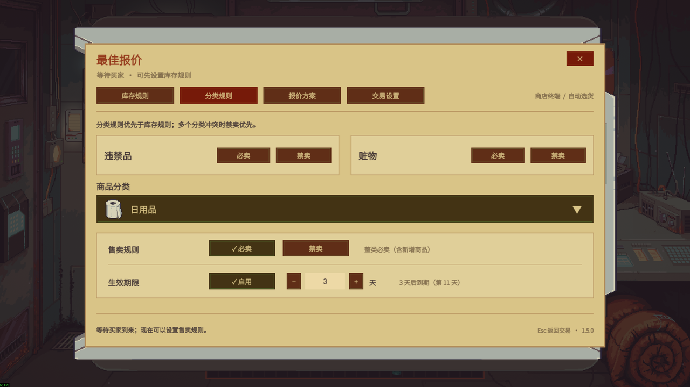
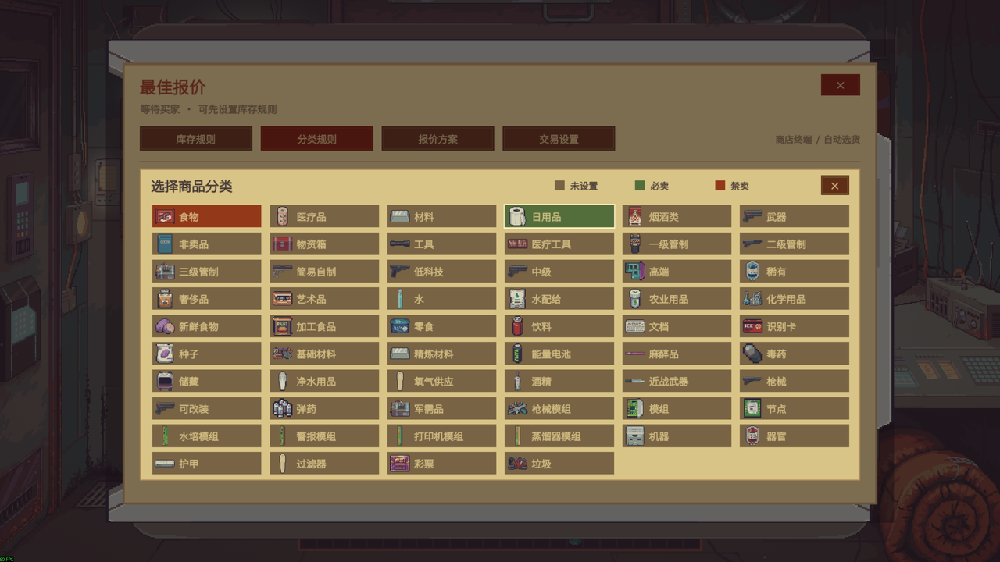

# 最佳报价 / Best Offer

为《深空当铺 / Probably Stolen Demo》提供智能选货、库存保护和一键摆货的 MelonLoader 模组。当前版本 **1.6.0**，按游戏语言自动显示中文或英文。[English README](README.en.md)

游戏语言为中文时保留原有中文界面；英文及其他语言使用英文。切换游戏语言后，面板、提示、分类与到期提醒自动刷新。物品、分类及物品特性直接读取游戏对应语言的原始文本；其他语言下也使用游戏的官方英文名称。原有库存、持续“全部”与分类规则继续生效，不需要重设。

[Nexus 下载与安装说明](https://www.nexusmods.com/probablystolen/mods/723) · [更新记录](https://www.nexusmods.com/probablystolen/mods/723?tab=bugs) · [GitHub 源码](https://github.com/DrNaki/ProbablyStolen-BestOffer)

## 实机演示

点击交易 iPad 的“一键摆货”，核对原生报价后手动成交。下方 GIF 来自作者重新录制的视频，保留完整画面与原速。

下方交易设置截图来自 1.4.3，分类规则截图来自 1.5.0。

## 使用

1. 进入店铺，按 **F8** 或点击交易 iPad 的齿轮“报价配置”。没有买家时也能设置库存规则。
2. 在“库存规则”中设置同名商品、数量或单件的必卖／禁卖。勾选右侧“全部”后，规则持续覆盖该存档里新增的同名商品；灰色数量框始终显示当前最大值。取消勾选后可编辑，数量保留为当时的最大值。药片瓶、试纸盒可进入“内容规则”设置单片。
3. 在“分类规则”中对游戏的全部商品分类设置必卖／禁卖，再次点击已勾选项即可取消；两项都不勾选时遵循库存规则。违禁品、赃物也只有两个售卖按钮，其中“禁卖”依次切换“关闭 → 禁卖 → 需求例外 → 关闭”，悬停可查看说明；需求例外只放行买家明确所需的商品，仍受库存规则和买家拒收限制。分类规则优先于库存规则，多个分类冲突时禁卖优先。
4. 在“交易设置”中选择货源、当天行情、包装拆售、超预算清货和快捷键。选项自动保存。
5. 买家到来后，点击 iPad 的“一键摆货”，或在面板中计算并查看方案。摆货不自动成交，核对后由玩家确认出售。

**F8、Esc 或右上角 ×** 可关闭面板；分类选择框展开时，Esc 先收起选择框。库存、买家、预算、事件或相关选项变化后，需要重新计算。

分类规则顶部并排显示违禁品和赃物，固定不限期。普通分类通过下拉卡片网格选择，无需翻页；每张卡片显示分类名与游戏中的代表物品图标（日用品使用卫生纸），以棕色／绿色／红色区分未设置／必卖／禁卖。少数分类在试玩版中只有空白图片，使用相关的现有物品图标。选中后在下方编辑该分类的售卖规则和生效期，各分类独立保存。

普通分类的“生效期限”默认不限时，“启用”未勾选时为棕色并隐藏天数；勾选后显示包含今天的剩余天数，数字每天递减，且始终可编辑。选择或修改天数后立即显示到期日，输入时同步预览；之后切换必卖／禁卖会保留这个到期日。修改天数后从今天起重新计算，再次点击“启用”取消则恢复不限时。模组悬停说明统一在停留 500 ms 后显示，移开立即隐藏。到期提示同步更新，临近时显示“后天到期”“明天到期”，同时标明具体游戏日。例如第 8 天设置禁卖 3 天，第 8–10 天禁卖，第 11 天解除，并在当天夜间报告末尾提醒。到期后恢复原有库存规则；分类设置按存档保存，不会覆盖其他存档。分类必卖仍需满足货源范围、买家接受、鉴定与预算限制。旧配置中尚在生效的违禁品／赃物限时规则迁移为不限期；已经到期的规则保持关闭。

## 当前版本的行为

- 库存“全部”是可取消的持续选择。勾选时禁用数量框和加减按钮，并提供悬停说明；取消时按当前库存转为固定数量，不恢复之前输入的值。单件修改会退出该组的“全部”；包装内部按各自包装独立保存，其他存档不继承。旧版按数量设置的规则保持原意，需手动勾选“全部”才会覆盖新增商品。
- 读取当前游戏日历正在生效的事件，可选择“不出售打折商品”和“优先出售加价商品”。折扣排除优先；加价商品优先后，普通商品可补足预算。两项默认关闭。
- “机器”和“产物”是独立货源，均默认关闭。机器电池、模块、投入原材料及工具箱中的工具不会被普通储藏箱选项连带取出；产物指机器专用输出位置的成品。各货源选项均提供简短悬停说明。
- 试纸盒、药片瓶等包装默认整体报价；“允许拆售包装耗材”默认关闭。内容中任一物品禁卖，会保护整件包装。
- 买家当前明确拒收违禁品时，自动报价和摆货同时排除违禁品及赃物，包括随容器出售的内容。明确需求例外、必卖或关闭分类保护均不能绕过此限制。
- 超预算清货默认关闭；开启后支持百分比或固定信用点。超出的部分是玩家放弃收取的金额。

## 安装与更新

测试环境：Windows x64，Probably Stolen Demo **050-Rev5-L / Steam build 26017150**，Unity **2021.3.45f2**，MelonLoader **0.7.3**。

先安装 MelonLoader 0.7.3（Windows x64）和 .NET 6 Desktop Runtime（Windows x64）。退出游戏，下载 [Nexus 主文件](https://www.nexusmods.com/probablystolen/mods/723?tab=files)，将其中的 Mods 文件夹合并到游戏根目录，最终为 Mods/BestOffer.dll。

更新时替换旧 DLL，不要同时保留多个版本。卸载时退出游戏并移走该 DLL。个人设置和单件规则保存在游戏目录的 UserData/BestOffer-settings.json 与 UserData/BestOffer-rules.json；持续“全部”规则另存于 UserData/BestOffer-all-rules.json，分类规则与到期提醒状态保存在 UserData/BestOffer-category-rules.json。更新无需删除。

## 构建与验证

需要 .NET SDK、游戏安装以及 MelonLoader 0.7.3。启动已安装 MelonLoader 的游戏一次，等待生成 MelonLoader/Il2CppAssemblies；将官方加载器文件置于 tools/melonloader/v0.7.3，或通过项目属性指定 MelonLoaderDir。

从项目根目录运行 scripts/Build.ps1，使用 -GameDir 指定游戏目录，加 -Reproducible 可启用可复现构建。脚本会运行报价求解、同名分组、风险策略、库存来源及分类规则测试，产物位于 dist/BestOffer.dll。构建不会自动部署到游戏。

当前构建通过 2,694 个本地化检查、73,332 个求解器断言及 3,600 个穷举对照、2,480 个分组断言、566 个风险断言、61 个库存来源检查和 366 个分类规则断言。另通过 631 项游戏原版名称映射检查。默认回滚到 1.5.0，已通过 27 个回滚场景。完整回滚包位于 rollback/BestOffer-1.5.0.zip，退出游戏后运行 scripts/Rollback.ps1 即可回退；个人配置与存档保持原样。

仓库包含模组源码、构建／安装脚本、测试和实机展示素材。游戏程序集、互操作程序集、加载器二进制、个人存档、配置及本地分析工具不在仓库中。依赖说明见 [THIRD-PARTY-NOTICES.md](THIRD-PARTY-NOTICES.md)。

## 反馈

请在 [Nexus Bugs](https://www.nexusmods.com/probablystolen/mods/723?tab=bugs) 或本仓库 Issues 提供游戏版本、模组版本、启用的其他模组及复现步骤。公开日志前请检查其中的个人路径与信息。

界面与游戏画面版权归原游戏权利人所有；展示素材来自实际游戏录制。作者：Naki & Codex。
