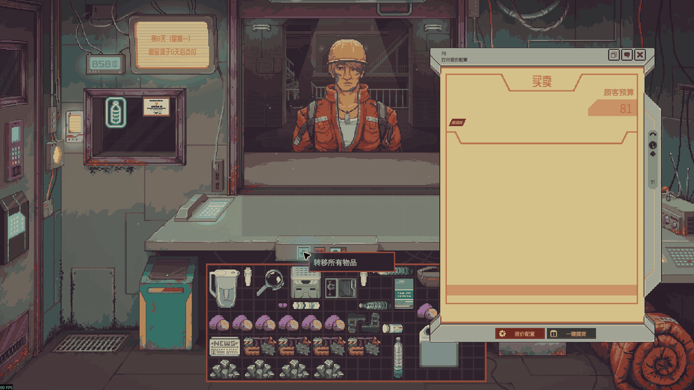
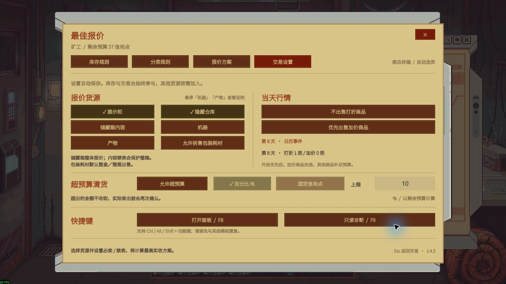

# 最佳报价 / Best Offer

为《深空当铺 / Probably Stolen Demo》提供智能选货、库存保护和一键摆货的 MelonLoader 模组。当前版本 **1.4.3**，界面为简体中文。

[Nexus 下载与安装说明](https://www.nexusmods.com/probablystolen/mods/723) · [更新记录](https://www.nexusmods.com/probablystolen/mods/723?tab=bugs) · [GitHub 源码](https://github.com/DrNaki/ProbablyStolen-BestOffer)

## 实机演示

默认配置：点击交易 iPad 的“一键摆货”，核对原生报价，再手动点击“接受报价”完成交易。录制仅加载 Best Offer 1.4.3 与 Mod Manager 1.2.5，没有启用其他模组。

## 使用

1. 进入店铺，按 **F8** 或点击交易 iPad 的齿轮“报价配置”。没有买家时也能设置库存规则。
2. 在“库存规则”中设置同名商品、数量或单件的必卖／禁卖；药片瓶、试纸盒可进入“内容规则”设置单片。
3. 在“分类规则”中分别设置违禁品、赃物保护及对应的明确需求例外。手动禁卖与当前买家拒收始终优先。
4. 在“交易设置”中选择货源、当天行情、包装拆售、超预算清货和快捷键。选项自动保存。
5. 买家到来后，点击 iPad 的“一键摆货”，或在面板中计算并查看方案。摆货不自动成交，核对后由玩家确认出售。

**F8、Esc 或右上角 ×** 可关闭面板。库存、买家、预算、事件或相关选项变化后，需要重新计算。

## 1.4.3 的行为

- 读取当前游戏日历正在生效的事件，可选择“不出售打折商品”和“优先出售加价商品”。折扣排除优先；加价商品优先后，普通商品可补足预算。两项默认关闭。
- “机器”和“产物”是独立货源，均默认关闭。机器电池、模块、投入原材料不会被普通储藏箱选项连带取出；产物指机器专用输出位置的成品。界面提供简短悬停说明。
- 试纸盒、药片瓶等包装默认整体报价；“允许拆售包装耗材”默认关闭。内容中任一物品禁卖，会保护整件包装。
- 买家当前明确拒收违禁品时，自动报价和摆货同时排除违禁品及赃物，包括随容器出售的内容。明确需求例外、必卖或关闭分类保护均不能绕过此限制。
- 超预算清货默认关闭；开启后支持百分比或固定信用点。超出的部分是玩家放弃收取的金额。

## 安装与更新

测试环境：Windows x64，Probably Stolen Demo **049-Rev5-L / Steam build 25382790**，Unity **2021.3.45f2**，MelonLoader **0.7.3**。

先安装 MelonLoader 0.7.3（Windows x64）和 .NET 6 Desktop Runtime（Windows x64）。退出游戏，下载 [Nexus 主文件](https://www.nexusmods.com/probablystolen/mods/723?tab=files)，将其中的 Mods 文件夹合并到游戏根目录，最终为 Mods/BestOffer.dll。

更新时替换旧 DLL，不要同时保留多个版本。卸载时退出游戏并移走该 DLL。个人设置和库存规则保存在游戏目录的 UserData/BestOffer-settings.json 与 UserData/BestOffer-rules.json，更新无需删除。

同时使用配套 **WarehouseSort 1.1.1** 时，请从 Nexus 可选文件下载 **BestOffer 1.4.3 Compat** 补丁。该补丁只扩展兼容版本白名单，整理逻辑不变。

## 构建与验证

需要 .NET SDK、游戏安装以及 MelonLoader 0.7.3。启动已安装 MelonLoader 的游戏一次，等待生成 MelonLoader/Il2CppAssemblies；将官方加载器文件置于 tools/melonloader/v0.7.3，或通过项目属性指定 MelonLoaderDir。

从项目根目录运行 scripts/Build.ps1，使用 -GameDir 指定游戏目录，加 -Reproducible 可启用可复现构建。脚本会运行报价求解、同名分组、风险策略及库存来源测试，产物位于 dist/BestOffer.dll。构建不会自动部署到游戏。

1.4.3 已通过 73,332 个求解器断言及 3,600 个穷举对照、2,448 个分组断言、566 个风险断言、47 个库存来源检查，以及 27 个回滚场景。拒收修复另通过原生巡逻警官实机验证。

仓库包含模组源码、构建／安装脚本、测试和实机展示素材。游戏程序集、互操作程序集、加载器二进制、个人存档、配置及本地分析工具不在仓库中。依赖说明见 [THIRD-PARTY-NOTICES.md](THIRD-PARTY-NOTICES.md)。

## 反馈

请在 [Nexus Bugs](https://www.nexusmods.com/probablystolen/mods/723?tab=bugs) 或本仓库 Issues 提供游戏版本、模组版本、启用的其他模组及复现步骤。公开日志前请检查其中的个人路径与信息。

界面与游戏画面版权归原游戏权利人所有；展示素材来自实际游戏录制。作者：Naki & Codex。
